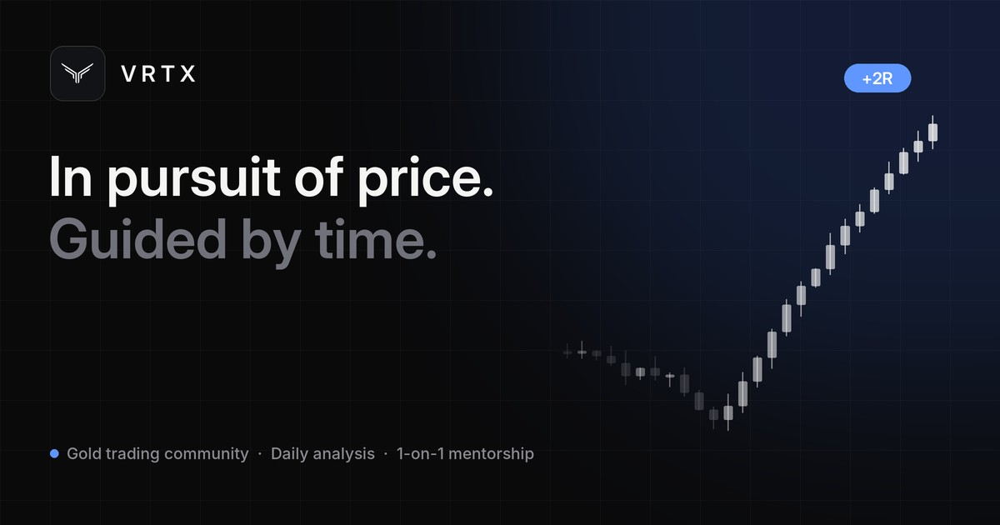

<p align="center">
  
</p>

<h1 align="center">VRTX</h1>

<p align="center">
  <strong>In pursuit of price. Guided by time.</strong><br />
  The official website of VRTX, a gold (XAUUSD) trading community and 1-on-1 mentorship led by Mirza Hammad.
</p>

<p align="center">
  
  
  
  
</p>

<p align="center">
  
</p>

---

## Overview

A single-page marketing site built to turn visitors into Discord members and mentorship clients. It is dark, fast and motion-led, with every piece of copy kept in one file so the site can be updated without touching components.

**Page sections**

| Section | What it does |
| --- | --- |
| Splash | 1.5 s candlestick loader shown on every load, inlined so it paints instantly |
| Hero | Headline, social proof and a looping showcase video |
| Approach | Three sticky cards (Analysis, Community, Mentorship) that stack as you scroll, each with an animated mock-up |
| Time > Price | The trading philosophy and its three principles |
| Mentor | Founder story with photo, highlights and quote |
| Trades | Recent results shared publicly on X |
| Daily | What members get each trading day |
| Membership | Free Discord vs. 1-on-1 mentorship (Instagram and WhatsApp contact) |
| Results | Verified member testimonials with original screenshots |
| Partners | Funding partners with click-to-copy discount codes |
| FAQ | Accordion of common questions |

## Features

- **Motion with restraint**: scroll-linked card stacking, a chart that draws on behind a scan line, staggered entrances, a cursor highlight on mock-ups. All of it is disabled for visitors who prefer reduced motion.
- **Fully responsive**: tested at 320, 360, 375, 430 and 768 px plus desktop. Cards scale to fit short laptop screens.
- **SEO ready**: descriptive meta tags, Open Graph and X cards, a 1200×630 share image, JSON-LD `Organization` data, `robots.txt` and `sitemap.xml` generated at build time.
- **Complete icon set**: `favicon.ico`, PNG favicons, Apple touch icon, PWA icons (including maskable) and a web manifest.
- **Lightweight**: no UI framework or animation library. Plain CSS, about 55 kB of gzipped JS, a WebP/MP4 hero video around 2.7 MB with a poster frame.

## Tech stack

- [React 18](https://react.dev) + [TypeScript](https://www.typescriptlang.org)
- [Vite 5](https://vitejs.dev) for development and builds
- Hand-written CSS with design tokens (no Tailwind or CSS-in-JS)
- [Vercel](https://vercel.com) for hosting
- Python + Pillow for generating brand assets, and ffmpeg for video encoding

## Getting started

Requires **Node.js 20+**.

```bash
git clone https://github.com/syedasjadabbas/vrtx-tradez.git
cd vrtx-tradez
npm install
npm run dev
```

The site runs at http://localhost:5173.

| Command | Description |
| --- | --- |
| `npm run dev` | Start the dev server with hot reload |
| `npm run build` | Type-check and build for production into `dist/` |
| `npm run preview` | Serve the production build locally |

> The npm scripts call Vite and TypeScript through `node node_modules/...` directly. This keeps them working in folders whose path contains characters such as `&`, which break npm's command shims on Windows.

## Project structure

```
├── index.html                 # Meta tags, structured data and the inline splash screen
├── public/
│   ├── video/                 # Hero video (webm, mp4) and poster frame
│   ├── testimonials/          # Original testimonial screenshots
│   ├── og-image.jpg           # Social share image (1200×630)
│   ├── mirza.webp / .jpg      # Mentor photo
│   └── favicon.ico, icon-*.png, site.webmanifest
├── src/
│   ├── content.ts             # ALL copy, links, plans, testimonials, partners and FAQ
│   ├── App.tsx                # Page sections
│   ├── main.tsx               # Entry, scroll reset and splash dismissal
│   ├── styles.css             # Design tokens, layout, animation and breakpoints
│   └── components/
│       ├── CandleChart.tsx    # Deterministic SVG candlestick chart
│       ├── Mocks.tsx          # Analysis, Discord and mentorship mock-ups
│       └── Icons.tsx          # Inline SVG icons
├── tools/
│   └── make_brand_assets.py   # Generates favicons, app icons and og-image.jpg
├── video/
│   ├── build.py               # Generates the hero video's scene description
│   └── project.json           # Generated scenes (candles, chat, cards, end card)
├── vercel.json                # Build settings, caching and security headers
└── vite.config.ts             # React plugin + SEO plugin (site URL, robots, sitemap)
```

## Editing content

Nearly everything a client would want to change lives in **`src/content.ts`**:

- `links`: Discord, Instagram, X, Linktree, mentorship and WhatsApp URLs
- `stats`, `pillars`, `principles`, `daily`: section copy
- `mentor`: name, role, photo, story, highlights and quote
- `trades`: recent results (newest first)
- `plans`: membership tiers and their buttons
- `testimonials`: quotes, names, dates and screenshot paths in `public/testimonials/`
- `partners`: funding partners, affiliate links and codes
- `faqs`: questions and answers

Change the brand colour by editing `--accent` at the top of `src/styles.css`.

## Brand assets

Favicons, app icons and the social share image are generated from the logo:

```bash
pip install pillow numpy
python tools/make_brand_assets.py --fonts /path/to/inter-fonts
```

The `--fonts` folder needs Inter and Inter Display `.otf` files. The original logo is small, so the script rebuilds the mark as a clean, smooth shape before rendering each size.

## Hero video

The hero video is an original motion-graphics piece generated from code. `video/build.py` writes `video/project.json`: chart candles, Discord messages, result cards and the end card, all as animated layers. That project is rendered with a Python motion-graphics renderer, then encoded for the web:

```bash
python video/build.py
# render video/project.json to video/out/vrtx-hero-master.mp4 (renders are git-ignored)
ffmpeg -i video/out/vrtx-hero-master.mp4 -an -c:v libx264 -preset slow -crf 28 -tune grain -pix_fmt yuv420p -movflags +faststart public/video/vrtx-hero.mp4
ffmpeg -i video/out/vrtx-hero-master.mp4 -an -c:v libvpx-vp9 -b:v 0 -crf 36 -row-mt 1 public/video/vrtx-hero.webm
ffmpeg -ss 1.7 -i video/out/vrtx-hero-master.mp4 -frames:v 1 -q:v 3 public/video/vrtx-hero-poster.jpg
```

## Deployment

The project is preconfigured for Vercel through `vercel.json`:

1. Import the repository at **vercel.com → Add New → Project**.
2. Keep the detected settings (framework, build command and output directory come from `vercel.json`) and deploy.
3. Every push to `main` redeploys automatically.

**Site URL.** Canonical links, Open Graph tags, `robots.txt` and `sitemap.xml` use absolute URLs. On Vercel the production domain is detected automatically. When a custom domain is connected, add an environment variable and redeploy:

```
SITE_URL=https://your-domain.com
```

`vercel.json` also sets:

- **Long-term caching** for fingerprinted assets.
- **Sensible caching** for the video, images and icons.
- **Security headers**: `X-Content-Type-Options`, `X-Frame-Options`, `Referrer-Policy` and `Permissions-Policy`.

## Accessibility and performance

- Semantic sections, labelled links and buttons, and alt text on images.
- `prefers-reduced-motion` is respected everywhere: the splash, the card stacking, the chart drawing, the video autoplay and the reveals.
- Images are lazy-loaded with explicit dimensions. The mentor photo is served as WebP with a JPEG fallback.
- The video is muted, plays inline and loops, and shows a preloaded poster frame until it starts.

## Disclaimer

Trading foreign exchange, commodities and derivatives carries a high level of risk and may not be suitable for all investors. Content on this site is for educational purposes only and is not financial advice.

## Credits

Designed and developed by **[Zeploy Tech](https://www.zeploy.tech)**.

© 2026 VRTX. All rights reserved. This repository and its contents are proprietary and may not be copied or redistributed without permission.
